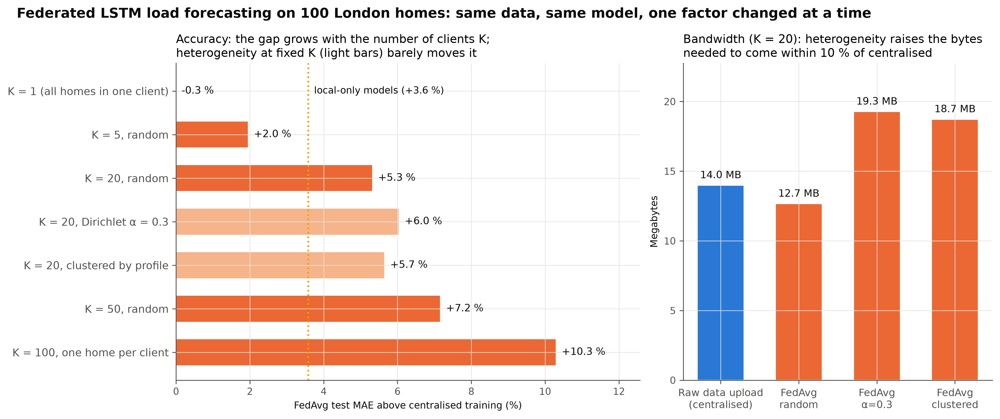

# What does heterogeneity cost? Federated LSTM load forecasting on London smart meters

Code, experiments and manuscript for a controlled, communication-priced study of federated
short-term load forecasting on the Low Carbon London (LCL) smart-meter data.

**Pushkal Gupta**\* · **Vanka Kaushik** · **Kalaavathi B**  
Department of Internet of Things, School of Computer Science and Engineering, Vellore Institute of Technology, Vellore, India  
\*Corresponding author: pushkal.gupta2023@vitstudent.ac.in

| | |
|---|---|
| **Data** | Low Carbon London (UK Power Networks), half-hourly kWh, 2013, 100 standard-tariff homes |
| **Task** | one home's last 24 h (48 half-hours) → its next half-hour |
| **Model** | one LSTM (64 hidden units, 17,217 parameters) shared by every arm |
| **Arms** | persistence · seasonal naive · local-only · centralised · FedAvg · FedProx · HA-FedProx · FedAvg + local fine-tuning |
| **Stack** | PyTorch; deterministic in-process FL simulator; optional Flower backend that reproduces it exactly |
| **Manuscript** | [`paper/manuscript.tex`](paper/manuscript.tex) → `paper/manuscript.pdf` (Elsevier `elsarticle`); Word versions in the IMRaD journal template: [`paper/docx/manuscript.docx`](paper/docx/manuscript.docx) (11 pages) and `manuscript_long.docx` (full length) |



---

## 1. The question

Federated learning (FL) lets homes train a shared forecaster without sending their readings
anywhere. Two claims are usually made for it: that household data are so heterogeneous that plain
FedAvg needs a fix, and that FL saves bandwidth. This repository tests both claims under one
controlled protocol. The households, the split, the model and the compute budget stay fixed, and
exactly one factor changes at a time:

| Factor | Settings |
|---|---|
| Pooling | local-only · centralised · federated |
| Fragmentation | the same 100 homes split into K = 1, 5, 20, 50 or 100 clients |
| Heterogeneity | random grouping → Dirichlet α ∈ {1, 0.3, 0.1} over load-profile clusters → fully clustered |
| Participation | all clients, or 50 % per round with 20 % stragglers |
| Aggregation | FedAvg · FedProx · HA-FedProx |
| Update precision | float32 or float16 |

Because every arm is scored on the same test half-hours, any difference in error comes from the
factor that changed.

## 2. Contributions

1. **Gap decomposition.** The federated-vs-centralised gap is split into four costs: the round
   protocol (one client holding all the data), fragmentation (the same homes over K clients),
   heterogeneity, and participation.
2. **Measured heterogeneity.** A label-free index H between clients: the Jensen–Shannon divergence
   of hour-of-week load shapes plus the dispersion of mean load, computed on training data only.
   Results are plotted against measured H, not against nominal α.
3. **Communication-priced accuracy.** An exact byte ledger (upload + download) and two metrics:
   **R@ε** and **B@ε**, the rounds and megabytes needed to come within ε = 10 % of centralised
   validation MAE. Both are compared with the raw-data volume that pooling would move.
4. **Equity.** For each household, the federation benefit over training alone, the share of homes
   that federation makes worse off, errors by consumption quintile, and paired Wilcoxon tests with
   Holm correction.
5. **HA-FedProx and a negative result.** HA-FedProx schedules FedProx's μ every round from a bounded
   update-space estimate of FedProx's B-dissimilarity: ρ_t = Σp‖Δk−Δ̄‖² / Σp‖Δk‖². It costs nothing
   extra to compute. We show why this signal follows training progress rather than heterogeneity
   on household load data.

Positioning against prior work is documented in [`paper/LITERATURE_NOTES.md`](paper/LITERATURE_NOTES.md).
In particular, Briggs et al. (2022) already observed plain FL losing to local models on LCL; this
study quantifies where the loss comes from and what it costs in bytes.

## 3. Results

<!-- RESULTS -->
All numbers below are real-data results on 100 LCL households: means over 3 seeds, computed on the
same 292,052 test half-hours. They are generated by `make_report` (`results/metrics/`).

### Main comparison

| Method | MAE (kWh) | RMSE (kWh) | MAPE* (%) | WAPE (%) | Best round / rounds | Communication (MB) | Raw data leaves home | Seeds |
|---|---|---|---|---|---|---|---|---|
| Persistence (naive) | 0.0890 | 0.1987 | 41.06 | 37.64 | n/a | 0.0 | n/a | 1 |
| Seasonal naive (t−48) | 0.1332 | 0.2773 | 63.62 | 56.33 | n/a | 0.0 | n/a | 1 |
| Local-only LSTM | 0.0840 ± 0.0003 | 0.1779 ± 0.0006 | 37.27 ± 0.40 | 35.52 | n/a | 0.0 | No | 3 |
| Centralised LSTM (pooled raw data) | 0.0811 ± 0.0003 | 0.1718 ± 0.0015 | 36.66 ± 0.81 | 34.30 | n/a | 14.0 | Yes | 3 |
| FedAvg, random (IID-ish) | 0.0853 ± 0.0009 | 0.1758 ± 0.0007 | 38.97 ± 0.61 | 36.07 | 23.0 / 30 | 82.6 | No | 3 |
| FedAvg, α=0.3 | 0.0861 ± 0.0004 | 0.1758 ± 0.0007 | 39.72 ± 0.15 | 36.42 | 24.0 / 30 | 82.6 | No | 3 |
| FedProx, α=0.3 | 0.0858 ± 0.0001 | 0.1755 ± 0.0006 | 39.50 ± 0.11 | 36.31 | 26.0 / 30 | 82.6 | No | 3 |
| HA-FedProx, α=0.3 | 0.0863 ± 0.0003 | 0.1765 ± 0.0005 | 39.62 ± 0.11 | 36.52 | 20.7 / 30 | 82.6 | No | 3 |
| FedAvg, cluster (strong) | 0.0857 ± 0.0003 | 0.1758 ± 0.0005 | 39.19 ± 0.17 | 36.24 | 22.0 / 30 | 82.6 | No | 3 |
| FedProx, cluster (strong) | 0.0858 ± 0.0002 | 0.1759 ± 0.0006 | 39.33 ± 0.16 | 36.29 | 23.3 / 30 | 82.6 | No | 3 |
| HA-FedProx, cluster (strong) | 0.0865 ± 0.0002 | 0.1772 ± 0.0008 | 39.54 ± 0.45 | 36.58 | 15.7 / 30 | 82.6 | No | 3 |
| FedAvg, α=0.3, 50% participation + 20% stragglers | 0.0849 ± 0.0004 | 0.1757 ± 0.0010 | 38.74 ± 0.50 | 35.92 | 24.0 / 30 | 37.4 | No | 3 |
| FedProx, α=0.3, 50% participation + 20% stragglers | 0.0857 ± 0.0003 | 0.1764 ± 0.0012 | 39.10 ± 0.25 | 36.24 | 20.7 / 30 | 41.3 | No | 3 |
| HA-FedProx, α=0.3, 50% participation + 20% stragglers | 0.0857 ± 0.0003 | 0.1769 ± 0.0011 | 39.14 ± 0.18 | 36.25 | 23.0 / 30 | 41.3 | No | 3 |
| FedAvg, α=0.3, float16 updates | 0.0858 ± 0.0005 | 0.1756 ± 0.0009 | 39.47 ± 0.27 | 36.28 | 25.3 / 30 | 41.3 | No | 3 |
| FedAvg, 1 household = 1 client | 0.0894 ± 0.0013 | 0.1816 ± 0.0009 | 40.90 ± 1.52 | 37.83 | 29.0 / 30 | 413.2 | No | 3 |
| FedProx, 1 household = 1 client | 0.0893 ± 0.0013 | 0.1817 ± 0.0011 | 40.68 ± 1.58 | 37.77 | 30.0 / 30 | 413.2 | No | 3 |
| HA-FedProx, 1 household = 1 client | 0.0901 ± 0.0005 | 0.1823 ± 0.0009 | 41.23 ± 0.80 | 38.11 | 29.3 / 30 | 413.2 | No | 3 |
| FedAvg, K=1 client(s), random | 0.0808 ± 0.0005 | 0.1710 ± 0.0003 | 36.70 ± 0.34 | 34.19 | 16.3 / 30 | 4.1 | No | 3 |
| FedAvg, K=5 client(s), random | 0.0827 ± 0.0005 | 0.1721 ± 0.0006 | 38.07 ± 0.22 | 34.97 | 23.0 / 30 | 20.7 | No | 3 |
| FedAvg, K=50 client(s), random | 0.0869 ± 0.0006 | 0.1782 ± 0.0005 | 39.57 ± 0.47 | 36.75 | 26.7 / 30 | 206.6 | No | 3 |

*MAPE over half-hours with actual load ≥ the configured threshold (0.05 kWh by default). Mean ± std over seeds. Centralised 'communication' is the raw training data volume (value + timestamp).

### Key findings

1. **The round protocol costs nothing.** FedAvg with one client holding all homes (K = 1) reaches
   0.0808 kWh against 0.0811 kWh for centralised training. The per-household difference
   is not significant (Holm p = 0.31).
2. **The federated gap is a fragmentation cost.** Splitting the same homes over more clients
   raises error steadily:

| K (clients) | Homes per client | H_JS | Test MAE (kWh) | + local FT | Gap to centralised |
|---|---|---|---|---|---|
| 1 | 100 | 0.0000 | 0.0808 ± 0.0005 | 0.0812 | -0.3 % |
| 5 | 20 | 0.0028 | 0.0827 ± 0.0005 | 0.0818 | +2.0 % |
| 20 | 5 | 0.0105 | 0.0853 ± 0.0009 | 0.0834 | +5.2 % |
| 50 | 2 | 0.0261 | 0.0869 ± 0.0006 | 0.0842 | +7.2 % |
| 100 | 1 | 0.0497 | 0.0894 ± 0.0013 | 0.0851 | +10.3 % |

   Regressing error on log K and the measured heterogeneity H_JS across 24 runs gives a
   significant effect of log K (p = 0.007). The heterogeneity term is not significant
   (p = 0.055).
3. **Heterogeneity costs bandwidth, not accuracy.** At K = 20, grouping homes from random to fully
   profile-clustered moves final MAE by at most 0.0012 kWh. It does raise the traffic needed to come
   within 10 % of centralised validation error (B@ε): 12.9 MB (random) →
   21.1 MB (α = 0.3) → 23.9 MB (clustered).
4. **FL is not the bandwidth-light option at this scale.** Uploading the raw training readings would
   move 14.0 MB. Thirty rounds move
   82.6 MB at K = 20 and
   413.2 MB with one client per home. Float16 updates
   halve the traffic at no accuracy cost (0.0858 vs 0.0861 kWh).
5. **Equity.** FedAvg (α = 0.3) is worse than a home's own local model for
   66 % of households, and for
   82 % with household clients. One epoch of local
   fine-tuning, which needs no communication, brings this down to
   48 %. Fine-tuned FedAvg is then tied with local
   models per household (Holm p = 0.50). The highest-consumption quintile gains most from
   pooled data, and is served worst by FedAvg.
6. **Proximal regularisation does not help.** Validation tuning picks the smallest μ
   (FedProx μ = 0.001, HA-FedProx μ₀ = 0.01). HA-FedProx is never better than
   FedAvg. Its signal ρ_t does rank heterogeneity (Spearman with H_JS ≈ +0.8). Its rise within a run,
   however, is about 40× its spread across partitions, so μ_t ∝ ρ_t acts as a convergence ramp.

Figures: `results/plots/` (also `paper/figures/`). The manuscript is in [`paper/manuscript.pdf`](paper/manuscript.pdf).
<!-- /RESULTS -->

## 4. Pipeline

```
LCL zip ─► preprocess ─► per-home scaler (train only) ─► 48→1 windows ─┬─► naive / local / centralised
                                                                         └─► partition ─► K clients
                                                    weights only  ▲            │ (data stays here)
                                                                  │            ▼
                                       server: sample → broadcast → local fit (+prox) → n_k-weighted mean
                                               → best round on validation → HA-FedProx μ update
                                               → byte ledger → metrics, statistics, plots, LaTeX tables
```

Implementation details, leakage controls and every formula are in [`docs/TECHNICAL.md`](docs/TECHNICAL.md).

## 5. Installation

Tested with Python 3.14.7 and torch 2.14.1 on macOS (CPU and Apple MPS). It should also work on any
Python ≥ 3.10 with these wheels, on CPU-only Linux/Windows or CUDA.

```bash
python3 -m venv .venv && source .venv/bin/activate    # Windows: .venv\Scripts\activate
pip install -r requirements.txt
pip install -r requirements-flower.txt                # optional Flower backend
python -m pytest                                      # unit tests
```

The device is picked automatically (CUDA, then MPS, then CPU). Force one with `--set train.device=cpu`.

## 6. Data

The LCL data are public but **not redistributed here** (≈ 800 MB zipped, 8.5 GB of CSV).

```bash
python -m src.data.download      # "Partitioned LCL Data.zip" (795,722,689 bytes) → data/raw/
python -m src.data.preprocess    # ≈ 40 s; cleaning report in data/processed/preprocess_report.json
```

You can also download `Partitioned LCL Data.zip` from the
[London Datastore](https://data.london.gov.uk/dataset/smartmeter-energy-consumption-data-in-london-households-vqm0d)
and put it, unzipped, in `data/raw/`. Cleaning rules and their counts are in [`data/README.md`](data/README.md).

## 7. Reproducing the paper

```bash
python -m src.experiments.run_demo                # synthetic-data smoke test, ~2 min → results/demo/
python -m src.experiments.run_matrix --phase tune --workers 8   # μ / μ0 selection on validation
python -m src.experiments.run_matrix --phase main --workers 8   # E0–E14 × 3 seeds (resumable)
python -m src.experiments.make_report             # CSVs, statistics, plots, paper/generated/*.tex
make paper                                        # paper/manuscript.pdf (tectonic or pdflatex)
make docx                                         # paper/docx/manuscript{,_long}.docx (IMRaD Word template)
```

The full matrix takes about 8 h on one Apple M5 Max with 8 parallel runs. Finished runs are skipped
on restart. Individual arms can be run on their own:

```bash
python -m src.experiments.run_baselines                       # naive + local + centralised
python -m src.experiments.run_fedavg  --set partition.strategy=dirichlet partition.alpha=0.3
python -m src.experiments.run_fedprox --set fed.mu=0.001
python -m src.experiments.run_fedprox --adaptive --set fed.mu=0.01      # HA-FedProx
python -m src.experiments.run_fedavg  --set partition.mode=household    # 1 home = 1 client
python -m src.experiments.run_fedavg  --set fed.client_fraction=0.5 fed.straggler_prob=0.2
python -m src.experiments.run_fedavg  --backend flower                  # same run through Flower
```

Every command accepts `--config`, `--set key=value …`, `--seed` and `--sample`. `--sample` runs on 10
real households with 3 rounds as a quick check.

### Experiment matrix (`configs/matrix.yaml`)

| ID | Arm | Factor |
|---|---|---|
| E0 | persistence, seasonal naive | reference |
| E1 | local-only | no collaboration |
| E2 | centralised | pooled raw data |
| E3 | FedAvg | random grouping, K = 20 |
| E4 / E5 | FedAvg / FedProx | Dirichlet α = 0.3 |
| E6 / E7 | FedAvg / FedProx | cluster grouping (strong non-IID) |
| E8 / E9 / E11 | FedAvg / FedProx / HA-FedProx | α = 0.3, 50 % participation, 20 % stragglers |
| E10 | FedAvg, FedProx, HA-FedProx | α ∈ {∞, 1, 0.3, 0.1, 0} sweep |
| E12 | FedAvg | α = 0.3, float16 updates |
| E13 | FedAvg, FedProx, HA-FedProx | one household per client (K = 100) |
| E14 | FedAvg | random grouping, K ∈ {1, 5, 50} |

Every row uses 3 seeds (42, 43, 44). FedProx μ and HA-FedProx μ₀ are tuned on validation data only
(`results/metrics/tuning.json`).

### Outputs

| Path | Content |
|---|---|
| `results/metrics/comparison.{csv,md}` | main table: MAE · RMSE · MAPE · WAPE · best round · traffic |
| `results/metrics/summary_by_experiment.csv` | every experiment, mean/std over seeds, R@ε, B@ε |
| `results/metrics/gap_decomposition.csv`, `fragmentation.csv` | where the federated gap comes from |
| `results/metrics/heterogeneity.csv`, `rho_vs_heterogeneity.csv` | H, ρ and error per partition |
| `results/metrics/stats_tests.csv` | paired Wilcoxon + Holm over households |
| `results/metrics/equity.csv`, `equity_by_stratum.csv` | who gains or loses from federation |
| `results/metrics/runs/` | every run: summary JSON, per-round history, per-household errors |
| `results/plots/*.png` | all figures (copied to `paper/figures/`) |
| `paper/generated/*.tex` | tables and `\newcommand` numbers used by the manuscript |

## 8. Metrics

| Metric | Definition | Note |
|---|---|---|
| MAE | mean \|y − ŷ\| (kWh per half-hour) | primary metric |
| RMSE | √mean(y − ŷ)² | weights large misses (peaks) |
| WAPE | 100 · Σ\|y − ŷ\| / Σy | scale-free, stable near zero |
| MAPE | 100 · mean \|y − ŷ\|/y over half-hours with y ≥ 0.05 kWh | plain MAPE is unbounded at night-time loads; the excluded share is reported |

Metrics are pooled over every test half-hour of every household (micro-average), in kWh after
inverse scaling.

## 9. Repository layout

```
configs/      default.yaml (real data) · demo.yaml (synthetic) · matrix.yaml (experiments)
data/         raw/ (LCL zip, not in git) · processed/ · clients/ · README.md
src/
  config.py utils.py
  data/         download · preprocess · window · partition · profiles · synthetic
  models/       lstm.py (the one model)
  baselines/    local · naive
  centralized/  train.py (shared training loop + centralised arm)
  federated/    client · server · fedavg · fedprox (HA-FedProx) · comm · flower_backend
  evaluation/   metrics · evaluate · plots · report
  experiments/  run_baselines · run_fedavg · run_fedprox · run_matrix · run_demo · make_report · common
results/      metrics/ · plots/ · logs/ · demo/ (synthetic only)
paper/        manuscript.tex · sections/ · refs.bib · generated/ · figures/ · LITERATURE_NOTES.md
  docx/       template.docx · content.tex (11 pages) · content_long.tex · build_docx.py · workflow_figure.py
docs/         TECHNICAL.md
tests/        test_core.py
```

## 10. Limitations

- **Data locality is not formal privacy.** Weight updates can leak information. Neither differential
  privacy nor secure aggregation is implemented.
- **The network is simulated.** Clients run in one process, and stragglers and dropouts are sampled.
  Traffic counts tensor payload only; Flower measures its framing overhead at about 1 %.
- **One dataset, one city, one year, one horizon.** The cohort is 100 of 4,034 eligible
  standard-tariff London homes, tested on Nov–Dec 2013, at a 30-minute horizon.
- **Evaluation is server-side.** For speed, the simulator scores the global model on every
  household's validation and test windows. In deployment this would be client-side `evaluate` calls.
- **Determinism.** Runs are bit-exact on CPU. On MPS and CUDA they may differ in the last digits.
- **Fixed hyper-parameters.** Learning rate, hidden size and window are fixed a priori for every arm.
  Only μ and μ₀ are tuned, on validation data.

## 11. Data and licence

The LCL data are published by UK Power Networks on the London Datastore under their own licence
and are not included here. The code is released for research use. Please cite the manuscript if
you use it.
