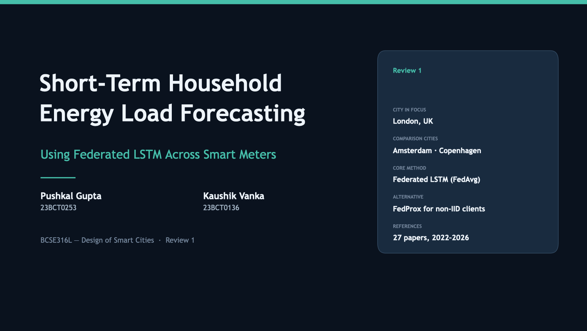

# Short-Term Household Energy Load Forecasting Using Federated LSTM Across Smart Meters

Working implementation, real-data experiments, manuscript draft and Review-1 deck for
**BCSE316L — Design of Smart Cities**.

| | |
|---|---|
| **Team** | Pushkal Gupta (23BCT0253) · Kaushik Vanka (23BCT0136) |
| **Data** | Low Carbon London smart meters (UK Power Networks), half-hourly, 2013 |
| **Task** | last 24 h (48 half-hours) of one home's load → next 30 min |
| **Model** | one LSTM (64 hidden units, 17,217 parameters) shared by every arm |
| **Arms** | naive · local-only · centralised · FedAvg · FedProx · **HA-FedProx** (new) |
| **Stack** | PyTorch, deterministic in-process FL simulator, optional Flower backend |
| **Deck** | [`deck/23BCT0253.pptx`](deck/23BCT0253.pptx) — Review 1, 29 slides |
| **Paper draft** | [`paper/manuscript.tex`](paper/manuscript.tex) → `paper/manuscript.pdf` |

---

## 1. Project overview

> Can many households collaboratively train an electricity-load forecasting model
> without any of them sending raw consumption data to a central server?

Each household (or a small community of households) is a **federated client**. It trains a
shared LSTM on its own half-hourly history and uploads only model weights. The server merges
those weights with FedAvg, with FedProx, or with HA-FedProx, the heterogeneity-adaptive variant
introduced here. Raw readings never leave the client.

## 2. Research objective and contributions

The comparison is controlled: Local-only, Centralised, FedAvg, FedProx and HA-FedProx all run
the same LSTM, the same preprocessing, the same per-household scaling and the same
48 → 1 horizon. Any difference in error is therefore caused by the learning strategy. On top of
that comparison the project adds:

1. **A heterogeneity dial with a measured x-axis.** The same 100 real households are regrouped
   into 20 clients from random to fully profile-clustered, with a Dirichlet-α dial over k-means
   load-profile clusters. A label-free index **H** (Jensen–Shannon divergence of hour-of-week
   load shapes plus dispersion of mean load) gives a heterogeneity–error response curve.
   The households and test set stay identical across levels.
2. **HA-FedProx.** The server re-tunes FedProx's μ every round from the disagreement ratio
   ρ_t ∈ [0, 1] of the client updates it already receives. It needs no extra communication and no
   extra client data.
3. **Communication-priced accuracy.** Exact byte ledger, error-vs-megabytes curves,
   **R@ε / B@ε** (the rounds and bytes needed to come within 10 % of centralised validation MAE),
   and a float16 update ablation.
4. **Equity of federation.** The per-household benefit over training alone, the share of homes
   harmed by federation, and errors by consumption quintile. FedAvg + 1-epoch local fine-tuning
   is reported as a zero-communication personalisation.
5. **Partial participation and stragglers.** 50 % of clients per round, 20 % of them stragglers
   with partial work. FedAvg drops stragglers; FedProx and HA-FedProx keep their partial work.

Statistical rigour: 3 seeds, naive baselines, model selection on validation only, and paired
Wilcoxon tests over households with Holm correction.

## 3. Architecture

```
LCL zip ─► preprocess ─► per-home scaler (train only) ─► 48→1 windows ─┬─► naive / local / centralised
                                                                         └─► partition ─► K clients
                                                    weights only  ▲            │ (data stays here)
                                                                  │            ▼
                                       server: select → broadcast → local fit (+prox) → n_k-weighted mean
                                               → validation-based best round → HA-FedProx μ update
                                               → byte ledger → metrics, plots, LaTeX tables
```

Details: [`docs/TECHNICAL.md`](docs/TECHNICAL.md).

## 4. Dataset setup

The real dataset is **not** included in this repository or its ZIP. It is about 800 MB
compressed, 8.5 GB of CSV, and governed by its own licence.

```bash
python -m src.data.download        # downloads "Partitioned LCL Data.zip" (795,722,689 bytes) into data/raw/
```

Or download it by hand from the
[London Datastore page](https://data.london.gov.uk/dataset/smartmeter-energy-consumption-data-in-london-households-vqm0d)
and put `Partitioned LCL Data.zip` in **`data/raw/`**. Do not unzip it. Loose CSVs and the
Kaggle "Smart meters in London" layout are also recognised. See [`data/README.md`](data/README.md).

## 5–6. Environment and installation

Tested with Python 3.14.7, torch 2.14.1 (CPU and Apple MPS), macOS 26. Any Python ≥ 3.10 for
which these wheels exist should work, as should CPU-only Linux/Windows or CUDA.

```bash
python3 -m venv .venv
source .venv/bin/activate                    # Windows: .venv\Scripts\activate
pip install -r requirements.txt              # deck + ML pipeline
pip install -r requirements-flower.txt       # optional: Flower backend
python -m pytest                             # 16 unit tests
```

`make venv` does the first three steps. Device selection is automatic: CUDA, then Apple MPS,
then CPU. Force one with `--set train.device=cpu`.

## 7. Folder structure

```
configs/          default.yaml (real data) · demo.yaml (synthetic) · matrix.yaml (all experiments)
data/             raw/ (LCL zip, not in git) · processed/ · clients/ · README.md
src/
  config.py utils.py
  data/           download.py preprocess.py window.py partition.py profiles.py synthetic.py
  models/         lstm.py                       ← the one model
  baselines/      local.py naive.py
  centralized/    train.py                      ← shared training loop + centralised arm
  federated/      client.py server.py fedavg.py fedprox.py comm.py flower_backend.py
  evaluation/     metrics.py evaluate.py plots.py report.py
  experiments/    run_baselines.py run_fedavg.py run_fedprox.py run_matrix.py run_demo.py make_report.py common.py
  build.py kit.py validate.py preview.py        ← Review-1 slide-deck generator (unchanged)
results/          metrics/ (CSV, JSON, per-run histories) · plots/ · models/ · demo/ (synthetic only)
paper/            manuscript.tex · refs.bib · generated/ (tables & numbers from results) · figures/
docs/             TECHNICAL.md · slide previews
tests/            test_core.py
deck/ tools/      Review-1 deck and the scripts used to read the source documents
```

## 8. Preprocessing

```bash
python -m src.data.preprocess                    # ~40 s on the full zip
python -m src.data.preprocess --set data.num_households=50 data.min_coverage=0.9
```

The defaults are: study year 2013, standard-tariff homes only, at least 95 % half-hourly
coverage, gaps of 2 h or less interpolated and longer gaps dropped, and 100 homes stratified by
train-period load quintile. The split is chronological (train Jan–Aug, val Sep–Oct, test
Nov–Dec), and every household's scaler is fitted on its own train split. The resulting counts
are listed in [`data/README.md`](data/README.md).

## 9–12. Running the arms

Every command accepts `--config FILE`, `--set key=value …`, `--seed N` and `--sample`
(10 real households, 3 epochs/rounds: a quick check on the real data).

```bash
# 9. local-only baseline (plus naive and centralised)
python -m src.experiments.run_baselines --only local
# 10. centralised baseline (pools raw windows from every household in one place)
python -m src.experiments.run_baselines --only centralized
python -m src.experiments.run_baselines              # naive + local + centralised
# 11. FedAvg (20 community clients, random grouping)
python -m src.experiments.run_fedavg
python -m src.experiments.run_fedavg --backend flower         # same run through Flower
# 12. FedProx / HA-FedProx
python -m src.experiments.run_fedprox --set fed.mu=0.01
python -m src.experiments.run_fedprox --adaptive --set fed.mu=0.1
```

**Centralised training needs every household's raw readings pooled on one server.** It is the
accuracy reference, not a privacy-preserving option.

## 13. Non-IID experiments

```bash
python -m src.experiments.run_fedavg  --set partition.strategy=iid                          # IID-ish
python -m src.experiments.run_fedavg  --set partition.strategy=dirichlet partition.alpha=0.3 # moderate
python -m src.experiments.run_fedprox --set partition.strategy=dirichlet partition.alpha=0.3
python -m src.experiments.run_fedavg  --set partition.strategy=cluster                       # strong
python -m src.experiments.run_fedprox --set partition.strategy=cluster
python -m src.experiments.run_fedavg  --set partition.mode=household                         # 1 home = 1 client
```

Non-IID-ness comes from real consumption: k-means on each home's train-period daily load shape
and level. The Dirichlet α controls how concentrated each client is on one profile, and H
measures the result.

## 14. Partial participation and stragglers

```bash
python -m src.experiments.run_fedavg  --set fed.client_fraction=0.5 fed.straggler_prob=0.2 partition.strategy=dirichlet partition.alpha=0.3
python -m src.experiments.run_fedprox --set fed.client_fraction=0.5 fed.straggler_prob=0.2 partition.strategy=dirichlet partition.alpha=0.3
```

## 15. Full matrix, results and plots

```bash
python -m src.experiments.run_demo                     # SYNTHETIC software check, ~2–4 min → results/demo/
python -m src.experiments.run_matrix --workers 8       # E0–E13 × 3 seeds on real data (resumable)
python -m src.experiments.make_report                  # tables, stats, plots, paper/generated/*.tex
make paper                                             # paper/manuscript.pdf (tectonic or pdflatex)
```

Outputs:

| File | Content |
|---|---|
| `results/metrics/comparison.csv` / `.md` | Method · MAE · RMSE · MAPE · WAPE · rounds · communication |
| `results/metrics/{local,centralized,naive,fedavg,fedprox}_results.csv` | per-arm summaries (mean/std over seeds) |
| `results/metrics/heterogeneity.csv` | H, ρ̄ and error per partition × algorithm |
| `results/metrics/stats_tests.csv` | paired Wilcoxon + Holm over households |
| `results/metrics/equity.csv`, `equity_by_stratum.csv` | who gains or loses from federation |
| `results/metrics/runs/*` | every run: summary JSON, per-round history, per-household metrics |
| `results/plots/*.png` | loss/MAE/RMSE/MAPE vs round, communication vs round, MAE vs MB, actual vs predicted, heterogeneity response, μ trajectory, equity |

<!-- RESULTS -->
### Results so far (real LCL data, partial: matrix still running)

> **Status (2026-10-08 16:30 IST):** 23 of 93 real-data runs are done (6 tuning runs plus 17 of 75 main runs).
> The table below contains **only completed runs**. Rows for E6–E13 appear after
> `run_matrix` finishes and `make_report` is re-run. Nothing here is extrapolated.

| Method | MAE (kWh) | RMSE (kWh) | MAPE* (%) | WAPE (%) | Best round / rounds | Communication (MB) | Raw data leaves home | Seeds |
|---|---|---|---|---|---|---|---|---|
| Persistence (naive) | 0.0890 | 0.1987 | 41.06 | 37.64 | n/a | 0.0 | n/a | 1 |
| Seasonal naive (t−48) | 0.1332 | 0.2773 | 63.62 | 56.33 | n/a | 0.0 | n/a | 1 |
| Local-only LSTM | 0.0840 ± 0.0003 | 0.1779 ± 0.0006 | 37.27 ± 0.40 | 35.52 | n/a | 0.0 | No | 3 |
| Centralised LSTM (pooled raw data) | 0.0811 ± 0.0003 | 0.1718 ± 0.0015 | 36.66 ± 0.81 | 34.30 | n/a | 14.0 | Yes | 3 |
| FedAvg, random (IID-ish) | 0.0853 ± 0.0009 | 0.1758 ± 0.0007 | 38.97 ± 0.61 | 36.07 | 23.0 / 30 | 82.6 | No | 3 |
| FedAvg, α=0.3 | 0.0861 ± 0.0004 | 0.1758 ± 0.0007 | 39.72 ± 0.15 | 36.42 | 24.0 / 30 | 82.6 | No | 3 |
| FedProx, α=0.3 | 0.0859 ± 0.0002 | 0.1758 ± 0.0007 | 39.50 ± 0.16 | 36.32 | 24.0 / 30 | 82.6 | No | 2 |

*MAPE over half-hours with actual load ≥ the configured threshold (0.05 kWh by default). Mean ± std over seeds. Centralised 'communication' is the raw training data volume (value + timestamp).

Tuning (validation only, cluster partition, seed 42): FedProx μ ∈ {0.001, 0.01, 0.1} picked **μ = 0.001**.
HA-FedProx μ₀ ∈ {0.01, 0.1, 1.0} picked **μ₀ = 0.01**. See `results/metrics/tuning.json`.

What the completed runs show so far:
- **Every LSTM beats persistence and seasonal naive.** Seasonal naive is much worse (0.133 kWh) than
  persistence (0.089 kWh) at a 30-min horizon.
- **Gap to centralised:** FedAvg with random grouping is about 5 % worse in MAE than the pooled centralised
  model (0.0853 vs 0.0811 kWh). With α = 0.3 the gap grows slightly (0.0861).
- **Local-only beats FedAvg on pooled MAE** (0.0840 vs 0.0853–0.0861), but FedAvg has the lower RMSE. Whether
  this holds per household, and for which load tiers, is tested in `stats_tests.csv` / `equity.csv`.
- **The proximal term barely matters here.** Tuning chose the smallest μ, and FedProx is within one standard
  deviation of FedAvg at α = 0.3. The update-disagreement ratio ρ stays high (about 0.8–0.87) in every tuning
  run, so the adaptive rule has little signal to adapt to. We report this as a negative result.
- **Communication:** 30 rounds × 20 clients × 68.9 kB × 2 directions = 82.6 MB. That is about 6× the raw
  training data the centralised arm uploads (14.0 MB). For one-step forecasting with a small per-home dataset,
  federation buys data locality, not bandwidth savings. Reaching within 10 % of the centralised
  validation MAE (B@ε) takes about 12.9 MB (4.7 rounds) with random grouping and about 21 MB (7.7 rounds)
  at α = 0.3. That is roughly the raw-data volume, so heterogeneity raises the communication price of
  near-central accuracy by about 60 %.
<!-- /RESULTS -->

## 16. Metrics

| Metric | Definition | Why |
|---|---|---|
| MAE | mean \|y − ŷ\| in kWh per half-hour | typical size of a miss; robust |
| RMSE | √mean(y − ŷ)² | punishes large misses, e.g. the evening peak |
| MAPE | 100·mean \|y − ŷ\|/y **over points with y ≥ 0.05 kWh** | scale-free, but undefined near zero load; the masked share is reported |
| WAPE | 100·Σ\|y − ŷ\|/Σy | scale-free and stable near zero |

MAPE is masked because household load is often close to zero overnight, which makes plain MAPE
explode. The threshold is `eval.mape_min_actual`. Read MAPE together with MAE and WAPE, never alone.

## 17. Limitations

- **Data locality is not formal privacy.** Weight updates can leak information. No differential
  privacy or secure aggregation is implemented.
- **Simulation.** Clients run in one process; there are no real networks, batteries or delays.
  Stragglers and dropouts are sampled. Communication counts tensor payload bytes only; Flower
  measures its framing overhead at about 1 %.
- **One dataset, one year, one city.** 100 of 4,034 eligible standard-tariff London homes, a
  winter test period (Nov–Dec 2013), 30-minute horizon only. Results may not transfer to other
  climates, tariffs or horizons.
- **Community clients are a modelling choice.** Grouping 5 homes per client represents a
  building or community gateway. The literal 1-home-1-client setting is reported separately (E13).
- **Server-side evaluation.** For speed, the simulator evaluates the global model on all
  households' validation and test windows centrally. In deployment, that would be client-side
  `evaluate` calls returning only metrics.
- **MPS/GPU non-determinism.** Seeds make runs repeatable, but bit-exact equality is guaranteed
  only on CPU.
- **Hyper-parameters** (lr, hidden size, window) are fixed a priori and not tuned per arm. Only
  μ and μ_0 are tuned, on validation data.

## 18. Reproducibility

- One config tree (`configs/`) plus `--set` overrides. Every run stores its settings in its summary JSON.
- Seeds for Python, NumPy and PyTorch (`src/utils.py::set_seed`). The cohort uses a separate
  `data.selection_seed`, so all seeds see the same households.
- `python -m pytest` checks metric formulas, leakage rules, partition integrity, the FedAvg
  weighting, FedProx(μ=0) ≡ FedAvg and seeded reproducibility.
- `run_matrix` is resumable: finished runs are skipped.
- To reproduce every number in `results/` and `paper/generated/`:

```bash
pip install -r requirements.txt
python -m src.data.download
python -m src.experiments.run_matrix --workers 8
python -m src.experiments.make_report
```

---

## Review-1 slide deck (unchanged pipeline)

Every slide is emitted by `src/build.py` from the layout kit `src/kit.py`. **Edit the script, not
the `.pptx`.**

```bash
make deck      # regenerate deck/23BCT0253.pptx
make check     # geometry check (5 known, visually verified warnings)
make preview   # render every slide to preview/*.png (macOS only)
```

| Path | Purpose |
|---|---|
| `src/kit.py` | design tokens and layout primitives (`slide`, `head`, `card`, `bullets`, `table`, `divider`) |
| `src/build.py` | all slide content, in presentation order |
| `src/validate.py` | shapes outside the canvas, text likely to overflow |
| `src/preview.py` | renders each slide to PNG via `qlmanage` |
| `tools/dump_docx.py`, `tools/dump_pptx.py`, `tools/inspect_pptx_style.py` | readers used to build the deck from the source documents |

The Review-1 deck is kept as submitted. Its methodology slides (pipeline, FedAvg/FedProx,
profile-based partitioning, straggler simulation, communication accounting) match the
implementation. Slide 26's results table deliberately shows dashes, because Review 1 predates the
experiments. Real numbers are in `results/` and `paper/`.

Design tokens: background `#0A121E`, card `#142030`, accent `#46BEAA`, warning `#E0A050`;
typeface Trebuchet MS.

## Notes and caveats

- **Privacy wording is deliberate:** the project claims data minimisation, not differential privacy.
- **Reference indexing is unverified.** The 27 deck references and the extra canonical
  references in `paper/refs.bib` were not checked against live Scopus/WoS records. Verify them
  before submission.
- **Novelty claims need a final literature check.** HA-FedProx and the heterogeneity-index
  protocol are new as far as this project's review goes. Search for the most recent adaptive-μ
  and heterogeneity-quantification work before submitting.


