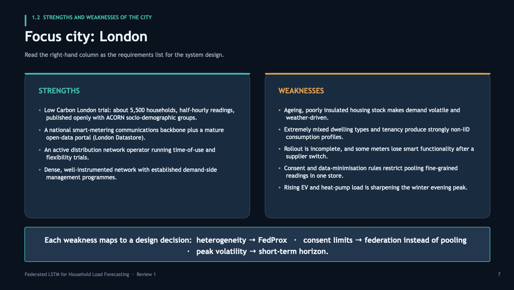

# Short-Term Household Energy Load Forecasting Using Federated LSTM Across Smart Meters

Review-1 presentation and slide-generation pipeline for **BCSE316L — Design of Smart Cities**.

| | |
|---|---|
| **Team** | Pushkal Gupta (23BCT0253) · Kaushik Vanka (23BCT0136) |
| **Deck** | [`deck/23BCT0253.pptx`](deck/23BCT0253.pptx) — 29 slides, 16:9 |
| **Focus city** | London, UK (comparison: Amsterdam, Copenhagen) |
| **Method** | Federated LSTM with FedAvg; FedProx as the non-IID alternative |
| **References** | 27 peer-reviewed journal articles, 2022–2026 |


---

## The project in one question

> Can many households collaboratively train an electricity-load forecasting model
> without any of them sending raw consumption data to a central server?

Smart meters produce high-resolution household demand series that are valuable for
peak-load planning — and revealing enough about occupancy and routine that pooling
them centrally runs into consent and data-minimisation limits.

The proposal treats each household as a **federated client**: it trains a shared LSTM
on its own history and uploads only weight tensors. The server merges those with
FedAvg, or with FedProx where household profiles diverge. Raw readings never leave
the home gateway.

The contribution is **not** that federated learning is new. It is a controlled
four-arm comparison — Local-only, Centralised, FedAvg, FedProx — run under one LSTM
architecture, one preprocessing pipeline and one forecast horizon, so that any
difference in error is actually attributable to federation rather than to a
confounding change in the model.

| Arm | Raw data leaves home? | Collaboration | Role |
|---|---|---|---|
| Local-only LSTM | No | None | Lower bound |
| Centralised LSTM | Yes | Total | Upper bound |
| FedAvg LSTM | No | Via weight averaging | Proposed |
| FedProx LSTM | No | Constrained by a proximal term | Non-IID variant |

Measured on MAE, RMSE and MAPE, plus convergence per communication round,
total bytes transferred, and degradation as client heterogeneity increases.



---

## Deck structure

The deck answers the numbered sections of the course question paper in order.

| Section | Slides |
|---|---|
| 1.1 Topic and context | 4–5 |
| 1.2 Strengths and weaknesses of the city | 6–7 |
| 1.3 Aim and objectives | 8 |
| 1.4 Scope and limitations | 9 |
| 2.1 Conceptual framework / research design | 11–12 |
| 2.2 Proposed idea | 13–14 |
| 2.3 Literature survey and research gaps | 15–19 |
| 2.4 Key features, challenges, benefits to the city | 20–22 |
| 2.5 Data collection and organisation | 23–24 |
| Evaluation plan, expected outcomes, summary, references | 25–29 |

---

## The deck is generated, not hand-drawn

Every slide is emitted by `src/build.py`. Nothing is positioned by dragging boxes in
PowerPoint, which is what keeps 29 slides visually consistent. **Edit the script, not
the `.pptx`** — a manual edit will be overwritten the next time the deck is built.

```bash
make venv      # create .venv and install python-pptx
make deck      # regenerate deck/23BCT0253.pptx
make check     # flag out-of-bounds shapes and likely text overflow
make preview   # render every slide to preview/*.png  (macOS only, uses qlmanage)
```

`make check` currently reports 5 warnings, all of them expected and visually verified:
the two oversized numerals on the section dividers, and three bullet lists whose text
box is nominally shorter than the card it sits inside. The estimator is deliberately
conservative — it approximates character widths rather than measuring the font. A
line prefixed `!` means a shape genuinely falls off the canvas; there are none.

### Layout

| Path | Purpose |
|---|---|
| `src/kit.py` | Design tokens and layout primitives — `slide`, `head`, `card`, `bullets`, `table`, `divider` |
| `src/build.py` | All slide content, top to bottom, in presentation order |
| `src/validate.py` | Geometry check: shapes outside the canvas, text likely to overflow its box |
| `src/preview.py` | Renders each slide to PNG by splitting the deck and calling `qlmanage` |
| `tools/dump_docx.py` | Dumps a `.docx` to text, tables included — used to read the source documents |
| `tools/dump_pptx.py` | Dumps a `.pptx` to text, shape by shape |
| `tools/inspect_pptx_style.py` | Prints shape positions, fonts and colours — used to recover the original palette |

### Design tokens

Defined once at the top of `src/kit.py`:

```
background  #0A121E      card     #142030      card (raised)  #1A283C
border      #25374D      accent   #46BEAA      warning        #E0A050
text        #EEF4FA      muted    #A4B5C6      dim            #76889E
```

Typeface is **Trebuchet MS** — chosen because it ships with both macOS and Windows
Office. Aptos and Calibri are not installed on every machine and fall back to a serif
substitute, which is what the earlier version of this deck did.

---

## Notes and caveats

- **Privacy wording is deliberate.** The deck claims *privacy-aware data minimisation*,
  not differential privacy. Federated learning keeps raw readings local, but model
  updates can still leak information. DP-SGD and secure aggregation are named as
  future extensions, never as results. Slide 9 states this explicitly.
- **No results are claimed yet.** Slide 26 is an intentionally empty comparison table.
  Review 1 covers problem formulation and design; the numbers arrive at Review 2.
- **Reference indexing is unverified.** The 27 references were carried over from the
  project draft with DOIs and venues checked against that draft, not against live
  Scopus/WoS records. Confirm indexing status before the written report — especially
  the 2026 entries.
- **Datasets are candidates, not commitments.** Low Carbon London is the intended
  primary source because it is the only openly published London household dataset at
  half-hourly resolution with socio-demographic labels. REFIT, UK-DALE and Pecan
  Street are listed as robustness checks.
- **Source documents are not in this repo.** The question paper and the earlier
  Review-1 draft were read to build the deck but have since been removed from disk,
  so they are not committed. `tools/dump_*.py` are the scripts that were used to read
  them.

---

## Deviation from the copy currently on the Desktop

`~/Desktop/23BCT0253.pptx` was edited by hand after the first build: the mark
allocations were stripped and "Digital Assignment 1" was changed to "Review 1".
Those edits are now folded into `src/build.py`, and two spots the manual pass missed
have been made consistent:

| Location | Desktop copy | This repo |
|---|---|---|
| Slide 10 kicker | `SECTION 2 · 12 MARKS` | `SECTION 2` |
| Footer, all 29 slides | `… · DA-1` | `… · Review 1` |

The deck in `deck/` is otherwise byte-for-byte equivalent in content. Use it in
preference to the Desktop copy.
